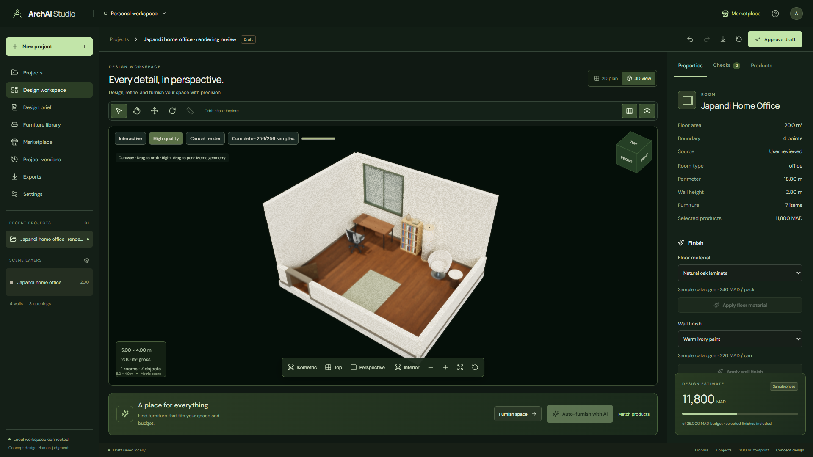
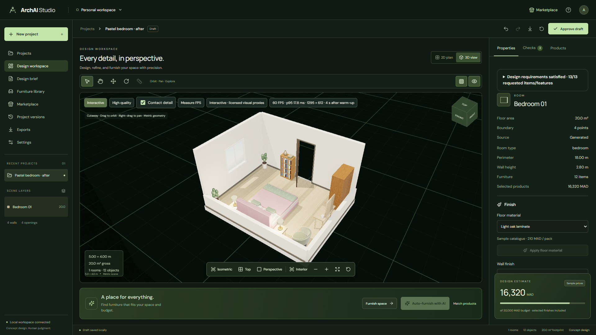
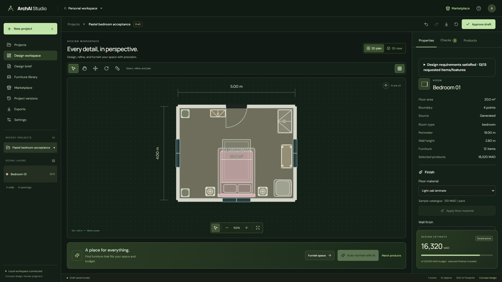
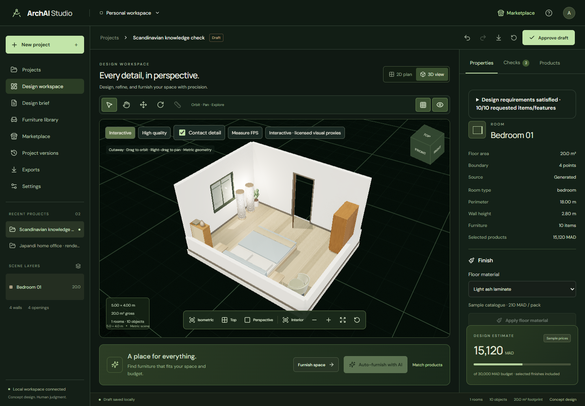
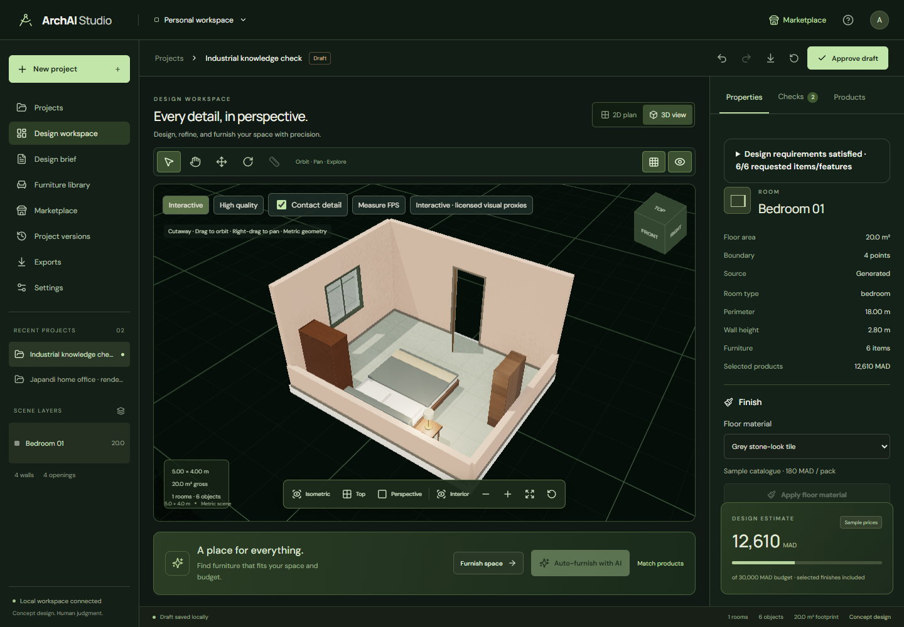

# ArchAI Studio

The [interior design knowledge base](docs/INTERIOR_DESIGN_KNOWLEDGE.md) guides generation with Scandinavian, Japandi, Korean Pastel, Modern Minimalist and Industrial profiles. Choose a style in the project form or design brief; inspect requested/template furniture, missing reasons and style coverage in the Inspector. Semantic ranking reuses the configured EmbeddingGemma model, with an explicit offline fallback.

The [pastel bedroom pipeline review](docs/BEDROOM_PIPELINE.md) documents quantity-aware generation, applied finishes, completeness reporting, isolated reproduction and [same-camera before/after screenshots](docs/bedroom/README.md).

A local workspace for exploring floor plans and interior layouts, based on [the project brief](ArchAI_Project_Documentation.pdf).

The application connects a React/TypeScript 2D and 3D editor to a FastAPI backend. One canonical scene drives both views. OR-Tools generates rectangular layouts, Shapely checks geometry, and LangGraph workflows place sample catalogue furniture and generate reviewable furniture/material recommendations. Drafts remain separate from approved snapshots.

## Example interiors

Actual screenshots from ArchAI Studio, showing furnished 5 × 4 m rooms, their floor plans and different style profiles. Click an image to view it at full size.

### Japandi home office

A walnut desk, ergonomic chair, filled bookshelf and reading corner in the optional high-quality rendering mode. [Scene details and asset credits](docs/RENDERING.md).

[](docs/rendering/office-high-quality.png)

### Pastel bedroom: 3D and floor plan

An upholstered bed, paired bedside tables, vanity, wardrobe and reading area. [Bedroom generation and verification](docs/bedroom/README.md).

| Furnished bedroom                                                                                                                     | 2D floor plan                                                                                                                               |
| ------------------------------------------------------------------------------------------------------------------------------------- | ------------------------------------------------------------------------------------------------------------------------------------------- |
| [](docs/bedroom/after-live.png) | [](docs/bedroom/plan.png) |

### Same room, different styles

The same room dimensions with different furniture, finishes and colours. [Style profiles and comparison evidence](docs/INTERIOR_DESIGN_KNOWLEDGE.md).

| Scandinavian                                                                                                                                             | Industrial                                                                                                                                               |
| -------------------------------------------------------------------------------------------------------------------------------------------------------- | -------------------------------------------------------------------------------------------------------------------------------------------------------- |
| [](docs/style-profiles/scandinavian.png) | [](docs/style-profiles/industrial.png) |

## Run locally

Prerequisites:

- Node.js 22.12 or newer, with npm.
- Python 3.11 or newer. Python 3.11 is the tested local interpreter.
- [uv](https://docs.astral.sh/uv/getting-started/installation/) for Python dependencies.
- [Ollama for Windows](https://docs.ollama.com/windows) for local AI features. Explicit room-list generation, editing and deterministic furnishing can run without inference.

The development machine has an NVIDIA RTX 5060 with 8 GB VRAM and 32 GB RAM. Install an appropriate NVIDIA driver for GPU inference; the backend also supports CPU inference. No hosted inference or API key is required.

From the repository root:

```powershell
npm ci
uv sync --project backend --locked
if (-not (Test-Path backend/.env)) {
  Copy-Item backend/.env.example backend/.env
}
npm run dev
```

The guarded copy preserves an existing local configuration. Dependencies install from `package-lock.json` and `backend/uv.lock`; [uv's locked sync](https://docs.astral.sh/uv/concepts/projects/sync/) checks that the Python lockfile matches the manifest.

| Service           | Address                                                              | Purpose                                  |
| ----------------- | -------------------------------------------------------------------- | ---------------------------------------- |
| Frontend          | [http://127.0.0.1:5173](http://127.0.0.1:5173)                       | Design workspace                         |
| FastAPI           | [http://127.0.0.1:8000](http://127.0.0.1:8000)                       | Backend; the root is not a frontend page |
| API documentation | [http://127.0.0.1:8000/docs](http://127.0.0.1:8000/docs)             | Interactive REST API                     |
| Health            | [http://127.0.0.1:8000/api/health](http://127.0.0.1:8000/api/health) | Backend availability                     |
| Ollama            | `http://127.0.0.1:11434`                                             | Local model server                       |

`npm run dev` starts FastAPI and Vite together. Stop them with Ctrl+C. To run them independently, use separate terminals from the repository root:

```powershell
# Terminal 1: FastAPI only
npm run dev:api
```

```powershell
# Terminal 2: frontend only
npm run dev:web
```

If FastAPI is already running on port 8000, start only `npm run dev:web`. Do not start a second backend on the same port. The backend command expands to:

```powershell
uv run --project backend uvicorn app.main:app --app-dir backend --host 127.0.0.1 --port 8000 --reload
```

The frontend proxies `/api` to `http://127.0.0.1:8000`. For a different backend address, set `$env:ARCHAI_API_URL` in the frontend terminal before starting Vite.

## Design workflow

Choose **Generate a plan**, enter the footprint and room requirements, and generate a draft. Select rooms, walls, or furniture to inspect them. **Furnish space** proposes sample furniture. Review **Checks**, then **Approve draft** to save an accepted snapshot. Drafts persist automatically; **Discard draft** returns to the last approved scene. The export button downloads scene JSON.

The workspace includes dimensional SVG furniture, drag/rotate tools, measurement, pan/zoom and actionable validation issues. The 3D view adds opaque walls with real opening voids, frames, baseboards, recognizable procedural furniture, PBR surfaces, daylight and soft shadows. Orbit/pan, fit/reset, top/isometric/perspective cameras and visibility controls share the same scene. Material assignments update the shopping list; subsequent wall/opening edits recalculate quantities.

Use **Design Brief** to edit budget/style, **Project Versions** to restore an approved snapshot as a reviewable draft, and the toolbar for persisted undo/redo. **Settings** stores local viewport preferences. **Auto-furnish with AI** runs the configured local Furniture Agent through LangGraph, then deterministic placement and validation. Review the candidate before approval; **Reject proposal** undoes that proposal. Further scene edits continue through the normal draft workflow.

**Upload a plan** accepts PDF, PNG, or JPG references. Confirm the full cropped footprint dimensions to create a rectangular review outline. OpenCV can overlay unreviewed line candidates; imported room topology and openings are not reconstructed automatically.

## Local AI models and configuration

Copy [backend/.env.example](backend/.env.example) as shown above, then edit the ignored `backend/.env`. Restart the backend after configuration changes. Shell environment variables take precedence over values loaded from the file.

The configured models match the user's installed local models:

| Role               | Configuration key           | Default model           | Current use                                                    |
| ------------------ | --------------------------- | ----------------------- | -------------------------------------------------------------- |
| Requirements       | `OLLAMA_REQUIREMENTS_MODEL` | `qwen3.5:4b`            | Structured text brief extraction                               |
| Supervisor         | `OLLAMA_SUPERVISOR_MODEL`   | `qwen3.5:4b`            | Reserved configuration; current entry routing is deterministic |
| Furniture          | `OLLAMA_FURNITURE_MODEL`    | `qwen3.5:4b`            | AI furnishing and optional recommendation ranking              |
| Materials          | `OLLAMA_MATERIALS_MODEL`    | `qwen3.5:4b`            | Optional material recommendation ranking                       |
| Design             | `OLLAMA_DESIGN_MODEL`       | `qwen3:8b`              | Design ordering for interpreted briefs                         |
| Correction         | `OLLAMA_CORRECTION_MODEL`   | `qwen3:8b`              | Bounded furniture correction proposals                         |
| Vision             | `OLLAMA_VISION_MODEL`       | `llava:latest`          | Experimental configuration; not automatically invoked          |
| Semantic retrieval | `OLLAMA_EMBEDDING_MODEL`    | `embeddinggemma:latest` | Semantic product search                                        |

To use the installed alternative embedding model, set `OLLAMA_EMBEDDING_MODEL=nomic-embed-text:latest`. The application never downloads model weights. If a configured model is absent, select an installed model in `.env`; model installation is a separate, explicit user action.

Open Ollama from the Windows Start menu. The [Windows application](https://docs.ollama.com/windows) normally serves its API in the background. If it is not running through the application, start `ollama serve` in another terminal. Use these [Ollama CLI commands](https://docs.ollama.com/cli) to inspect available and loaded models:

```powershell
ollama ls
ollama ps
```

Check both services without triggering model inference:

```powershell
Invoke-RestMethod http://127.0.0.1:11434/api/tags
Invoke-RestMethod http://127.0.0.1:8000/api/health
```

The health response's `model_configured` flag indicates that a requirements model name is configured. It does not prove that Ollama is reachable or that a model is installed.

| Setting                  | Default                  | Behavior                                       |
| ------------------------ | ------------------------ | ---------------------------------------------- |
| `OLLAMA_BASE_URL`        | `http://127.0.0.1:11434` | Local inference endpoint                       |
| `OLLAMA_NUM_CTX`         | `4096`                   | Context window sent to models                  |
| `OLLAMA_TIMEOUT_SECONDS` | `120`                    | Model request timeout in seconds               |
| `OLLAMA_FORCE_CPU`       | `false`                  | Set to `true` to request CPU inference         |
| `OLLAMA_CPU_FALLBACK`    | `true`                   | Retry a memory-related GPU failure once on CPU |

In the project dialog, expand **Interpret a text brief with Qwen** and enable text interpretation. **Auto-furnish with AI** requests a local agent proposal; **Furnish space** uses deterministic catalogue placement. Enable local AI ranking in marketplace recommendations when needed. Semantic search uses the configured embedding model.

LangChain ChatOllama returns structured requirements and a design ordering. The solver calculates coordinates, and geometry code validates the candidate. Requests are sequential and use `keep_alive=0` to release model memory. GPU memory failures retry once with `num_gpu=0`; `OLLAMA_FORCE_CPU=true` forces CPU inference. Model failures produce an error; they do not silently fall back to invented requirements. Without a configured model, the explicit room-list workflow works independently.

The queue covers this single backend process; other applications using Ollama are outside it. CPU inference can be slower. If a request times out, reduce context, select a smaller installed model or raise the configured timeout. Use `ollama ps` during a request to inspect CPU/GPU allocation; see the [Ollama runtime FAQ](https://docs.ollama.com/faq).

## Computer vision and local data

`CV_PROVIDER=opencv` uses lightweight line extraction. `CV_SEGMENTATION_FACTORY=module:function` optionally supplies a trusted local segmentation implementation; no trained CV model is bundled or downloaded. `llava:latest` is not used to claim automatic room reconstruction.

`CATALOGUE_PROVIDER=local_json` reads `data/catalogue.json`. Authorized product feeds can be integrated through `CATALOGUE_PROVIDER_FACTORY`; no commercial scraping runs automatically. All included prices and availability remain labelled `mock_data` in MAD.

`ARCHAI_DATA_DIR=.local` stores the project database and imported images. Back up that directory to retain local projects. Local `.env` files, databases, uploads, installed dependencies, model weights and generated test/build artifacts are excluded from Git. The tracked `.env.example` documents configuration without replacing personal settings.

## Furniture & Materials Marketplace

Open **Marketplace** from the header or **Furniture Library** from the sidebar. Browse 52 labelled mock records, filter by category, dimensions, style, color, material, brand and MAD price, and sort or use local semantic search. Select a design room to compare fit and free space, then add or replace products. **Try in my room** uses validated placement and opens the 3D view. Replacement preserves the object's ID, position and rotation when feasible. Surface selections calculate purchase quantities from stored coverage plus a configurable waste allowance.

The central [asset registry](apps/web/public/assets/registry.json) now includes eleven individually curated CC0 furniture models, local Poly Haven PBR scans and a 1k HDRI. The [asset manifest](apps/web/public/assets/manifest.json) records sources, authors, licenses and hashes. Models load lazily, are cached, merged by material and scaled uniformly within stored dimensions. Missing or invalid assets automatically use recognizable procedural furniture. See [interior rendering](docs/RENDERING.md) for asset credits, the 5 × 4 m Japandi review scene, render controls and reproducible measurements.

In 3D view, **Interactive** supports optional **Contact detail**, and **High quality** progressively path-traces the same scene and camera with progress and cancellation. **Interior** places the camera at eye level. **Measure FPS** reports continuously rendered frames and the actual drawing-buffer size. No assets are downloaded during installation or startup; the selected local files ship with the project.

**Recommendations** uses hard-filtered candidates, with optional local Furniture and Materials agents to rank and explain them. Accept/reject suggestions individually; only acceptance changes the draft. **Shopping list** shows quantities, dimensions, unit prices, subtotals, sample/confirmed/estimated totals, budget differences, and cheaper alternatives when available. Export CSV or PDF. There is no checkout or merchant inventory integration.

## Verification

```powershell
npm test
npm run lint
npm run format:check
npx playwright install chromium
npm run test:e2e
npm run build
```

`npm run format` formats the repository. `npm run typecheck` checks frontend types independently. Browser tests launch isolated services on ports 5174 and 8001 and use a separate database.

## Troubleshooting

- **Port already in use:** use the existing service or stop its terminal with Ctrl+C. Run only the missing frontend/backend command.
- **Backend unavailable in the workspace:** check `/api/health`, the FastAPI terminal and Vite's proxy target. The frontend requires the backend for projects and catalogue operations.
- **Cannot reach Ollama / model not installed:** open Ollama, check `/api/tags` and `ollama ls`, then match the endpoint and model tag in `backend/.env`. Restart FastAPI after edits.
- **GPU memory error:** close other model workloads, reduce context or set `OLLAMA_FORCE_CPU=true`. The automatic retry is limited to memory-related failures.
- **3D unavailable:** enable WebGL in a supported browser. The 2D plan and properties remain available. Missing registered furniture models use procedural fallbacks.

## Current limits

- This is an implemented starting foundation, not the complete research project described in the PDF.
- OpenCV produces line candidates; a configurable segmentation interface accepts a future local wall-mask model. Trained segmentation, room topology reconstruction, opening extraction, and perception evaluation remain unimplemented.
- Layouts use axis-aligned rectangles on a 0.1 m grid. Adjacency, circulation, daylight, services, and regulatory compliance are not solved. Door locations are review proposals.
- All catalogue products and prices are labelled samples. Geometry proxies represent dimensions; they are not licensed merchant models. Shipping, installation, tax assumptions, and unselected finishes are excluded from the estimate. Selected material quantities are included.
- Floor/wall materials use illustrative stored coverage and purchase-unit prices. Style guides product ranking; the spatial solver does not optimize aesthetics. Material quantities remain conceptual wall-centre-line estimates.
- LangGraph coordinates deterministic furnishing and sequential Furniture/Materials recommendation nodes. Qwen is optional for requirements, design ordering, recommendations and a bounded furniture-correction loop. Routing is deterministic for explicitly selected input paths; experimental vision and alternative embedding roles are configurable, but not automatically invoked.
- Wall endpoint corrections are validated against existing room boundaries. They do not automatically rebuild room topology.
- Storage is local SQLite and files in `.local/`. Services bind to loopback and have no authentication; they are intended for local development. The user chose local development. Hosted deployment and access-controlled multi-user projects need separate implementation.

See [architecture](docs/ARCHITECTURE.md), [testing](docs/TESTING.md), [project context](CONTEXT.md), and [handoff](HANDOFF.md). Working rules are referenced by [AGENTS.md](AGENTS.md).
